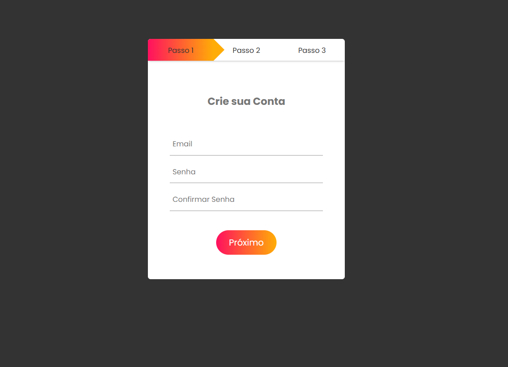

# 📝 Formulário com Etapas

Projeto de um formulário de cadastro dividido em três etapas, desenvolvido com **HTML5, CSS3 e JavaScript** como parte de uma atividade prática do curso PROA.

O projeto tem como objetivo explorar conceitos de criação de formulários interativos, manipulação de elementos HTML com JavaScript e desenvolvimento de animações de transição utilizando CSS, proporcionando uma experiência de cadastro organizada e dinâmica.

## 🖥️ Prévia do projeto

  

🔗 **[Acesse o projeto online](https://gabrielc0liveira.github.io/Projeto14Proa-FormulariocomEtapas/)**

## Funcionalidades e características

- Formulário de cadastro dividido em três etapas.
- Primeira etapa destinada à criação da conta, com email e senha.
- Segunda etapa para preenchimento de redes sociais.
- Terceira etapa para informações pessoais.
- Botões de navegação para avançar e retornar entre as etapas.
- Barra de progresso que acompanha a etapa atual do formulário.
- Transições animadas entre os diferentes formulários.
- Interface centralizada com campos de entrada personalizados.
- Botões e indicador de progresso com efeitos de gradiente.
- Navegação entre etapas controlada por JavaScript.

## Tecnologias utilizadas

- **HTML5:** estruturação dos formulários, campos de entrada e botões de navegação.
- **CSS3:** estilização, posicionamento, gradientes e animações de transição.
- **JavaScript:** manipulação dos elementos HTML, controle da navegação e atualização da barra de progresso.
- **Google Fonts:** utilização da fonte Poppins.

## Aprendizados

Durante o desenvolvimento, foram praticados conceitos como:

- Estruturação de formulários utilizando HTML.
- Organização de campos com diferentes tipos de `input`.
- Manipulação do DOM com `document.getElementById()`.
- Utilização de eventos `onclick` para controlar interações.
- Alteração dinâmica de propriedades CSS utilizando JavaScript.
- Criação de transições suaves com `transition`.
- Desenvolvimento de uma barra de progresso dinâmica.
- Posicionamento de elementos com `position: absolute` e `relative`.
- Aplicação de gradientes com `linear-gradient`.
- Controle da navegação entre diferentes etapas de um formulário.

## 📂 Como executar o projeto

🔗 **[Acesse o projeto online](https://gabrielc0liveira.github.io/Projeto14Proa-FormulariocomEtapas/)**

---

Desenvolvido por **Gabriel Oliveira** como parte das atividades práticas do PROA.
